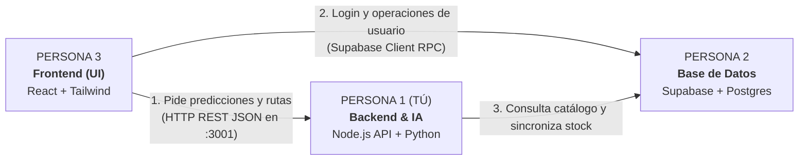

# 👥 Plan de Distribución de Trabajo para 3 Integrantes — Distribuidora TCA

Este documento formaliza la división de responsabilidades, entregables técnicos, contratos de integración y roles de sustentación para un equipo de **3 personas** en el proyecto **Distribuidora TCA (APF 3)**.

---

## 🎯 Resumen de Asignación por Roles

| Integrante | Rol Principal | Módulo Asignado | Tecnologías Clave | Rama Git Recomendada |
|---|---|---|---|---|
| **Persona 1 (TÚ)** | **Líder Backend & Ingeniero de Inteligencia Artificial** | `/back` | Python 3.12, Node.js, Scikit-Learn, Google Antigravity SDK | `feature/back-ai-api` |
| **Persona 2** | **Ingeniero(a) de Base de Datos & DevOps / Cloud** | `/bd` | PostgreSQL, Supabase, PGlite, GitHub Actions CI/CD | `feature/bd-cloud` |
| **Persona 3** | **Desarrollador(a) Frontend & UX/UI Designer** | `/front` | React 19, TypeScript, Tailwind CSS v4, Vite | `feature/front-ui` |

---

## 1. 🧠 PERSONA 1 (TÚ): BACKEND & INTELIGENCIA ARTIFICIAL

> **Módulo:** [`/back`](file:///c:/Users/User/.gemini/antigravity/scratch/Proyecto-TCA-React/back)  
> **Responsabilidad:** Lógica de negocio de servidor, API REST, algoritmos de búsqueda, modelos predictivos de Machine Learning y Copiloto Inteligente.

### 📦 Archivos que dominas y mantienes:
- `back/api/server.js`: Endpoints REST expuestos para el nuevo front (`/health`, `/api/catalogo`, `/api/ai/*`).
- `back/ai_analytics/search_algorithms.py`: Algoritmos $A^*$ (óptimo con heurística euclidiana), BFS, DFS y Hill Climbing.
- `back/ai_analytics/regression_models.py`: Regresión Lineal vs. Polinomial Grado 2 ($R^2 = 0.9977$) vs. Ridge G3.
- `back/ai_analytics/classification_models.py`: Regresión Logística Sigmoide ($F1 = 100\%$, $\text{AUC} = 1.0000$).
- `back/ai_analytics/ml_algorithms.py`: Ensambles y benchmark (SVM, KNN, Decision Tree, Boosting, Random Forest).
- `back/ai_analytics/tca_agent.py`: Agente Inteligente autónomo con Tool Calling y Google Antigravity SDK.
- `back/ai_analytics/APF3_TCA_Machine_Learning.ipynb`: Cuaderno Jupyter de experimentación y sustentación.
- `back/scripts/antigravity-code-quality.mjs`: Script de auditoría continua (100/100%).

### 🎯 Tareas y Entregables concretos:
1. **Mantener y expandir la API REST:** Si el nuevo front necesita nuevos datos (ej. filtros de productos, carrito o autenticación), agregas los endpoints en `back/api/server.js`.
2. **Servir predicciones de IA:** Asegurar que los endpoints `/api/ai/predict-demand` y `/api/ai/stockout-risk` respondan en milisegundos con JSON limpio.
3. **Sustentación ante el evaluador:** Explicar el modelado matemático ($A^*$, formulación polinomial, función sigmoide y validación cruzada $k=5$).

---

## 2. 🗄️ PERSONA 2: BASE DE DATOS & CLOUD DEVOPS

> **Módulo:** [`/bd`](file:///c:/Users/User/.gemini/antigravity/scratch/Proyecto-TCA-React/bd)  
> **Responsabilidad:** Integridad relacional, seguridad de accesos por roles (RLS), semillas reproducibles y pipeline de CI/CD.

### 📦 Archivos que domina y mantiene:
- `bd/supabase/migrations/`:
  - `001_hu11_productos.sql`: Catálogo, productos, tablas maestras y RLS.
  - `002_hu12_pedidos_borrador.sql`: Borradores atómicos de pedidos, reservas y líneas.
  - `003_operacion_integral.sql`: Kardex, movimientos de almacén, reposición y transacciones.
- `bd/supabase/seed.sql`: Script reproducible para cargar los 160 productos sin duplicados.
- `bd/tests/database.test.mjs`: Suite de 19 pruebas de integración con PostgreSQL en memoria (`npm run test:bd`).
- `.github/workflows/ci-cd.yml`: Configuración del pipeline de CI/CD de 4 etapas en GitHub Actions.

### 🎯 Tareas y Entregables concretos:
1. **Garantizar las políticas RLS:** Verificar que el usuario anónimo no pueda ver precios internos ni modificar inventario, y que Ventas no pueda autorizar despachos.
2. **Gestión de Supabase en la Nube:** Crear el proyecto en Supabase Cloud, ejecutar las migraciones SQL y configurar las variables en el `.env`.
3. **Monitoreo del CI/CD:** Asegurar que cada `git push` pase las pruebas automáticas en GitHub Actions.
4. **Sustentación ante el evaluador:** Explicar el Criterio 1 de la rúbrica (DevOps, CI/CD, despliegue cloud y control de concurrencia en BD).

---

## 3. 💻 PERSONA 3: FRONTEND & EXPERIENCIA DE USUARIO

> **Módulo:** [`/front`](file:///c:/Users/User/.gemini/antigravity/scratch/Proyecto-TCA-React/front)  
> **Responsabilidad:** Construcción de la nueva interfaz visual, componentes interactivos, consumo de la API de Backend y conexión con Supabase.

### 📦 Archivos que domina y mantiene:
- `front/src/pages/`: Vistas de usuario (`HomePage`, `CatalogPage`, `APF3AnalyticsPage`, `InventoryPage`, `OrdersPage`).
- `front/src/components/`: Componentes UI reutilizables (Navbar, Cards, Modales, Filtros, Carrito).
- `front/src/types/index.ts`: Definición de tipos e interfaces de datos (contratos TypeScript).
- `front/src/domain/validation.ts`: Reglas de validación de entradas de usuario (HU11, HU12).
- `front/vite.config.ts` y `front/src/index.css`: Configuración de estilos y bundler.

### 🎯 Tareas y Entregables concretos:
1. **Crear o renovar la interfaz de usuario:** Diseñar la nueva visual moderna, responsiva y accesible para clientes y administradores.
2. **Consumir el Backend de Persona 1:** Hacer peticiones `fetch()` a la API en `http://localhost:3001/api/` para obtener catálogo y simulaciones de IA.
3. **Consumir la Base de Datos de Persona 2:** Usar el cliente `@supabase/supabase-js` con las variables de `.env` para login y pedidos.
4. **Sustentación ante el evaluador:** Demostrar en vivo el Dashboard de APF 3, la navegación, la usabilidad y la experiencia de usuario.

---

## 🔄 Contrato de Comunicación entre los 3 Integrantes

---

## 🚀 Flujo de Trabajo en Git (Para no pisarse el código)

1. **Cada persona trabaja en su carpeta:**
   - Tú (Backend) solo tocas `/back`.
   - Persona 2 solo toca `/bd`.
   - Persona 3 solo toca `/front`.
2. **Ramas independientes:**
   - Tú creas: `git checkout -b feature/back-ai`
   - Persona 2 crea: `git checkout -b feature/bd-supabase`
   - Persona 3 crea: `git checkout -b feature/front-ui`
3. **Al terminar:** Cada uno sube su rama y hace un Pull Request hacia `APF-03` o `main`. Como los archivos están separados en carpetas distintas, **¡NUNCA HABRÁ CONFLICTOS DE MERGE!**
